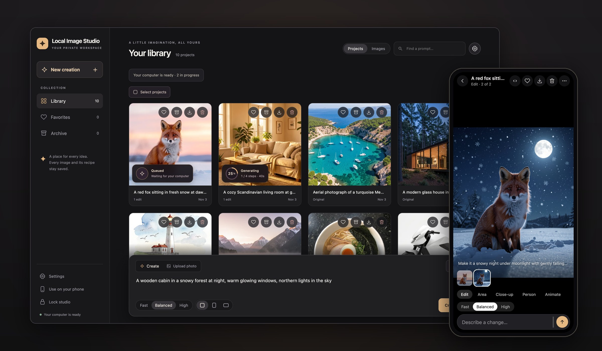
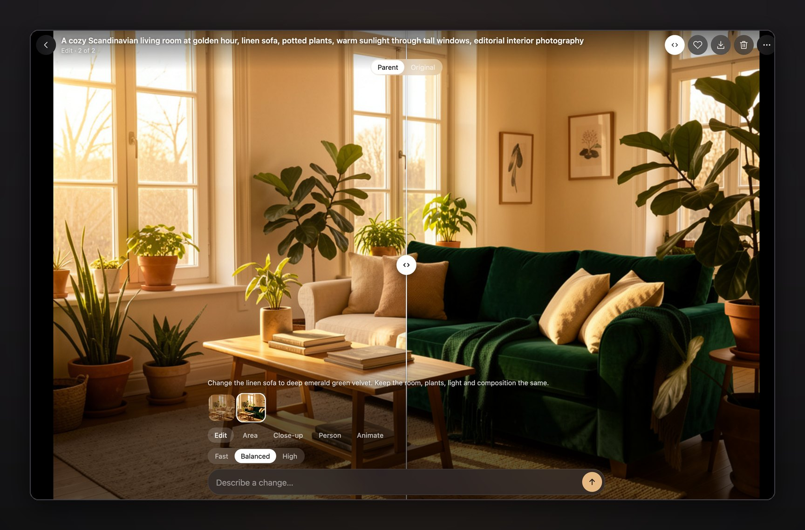
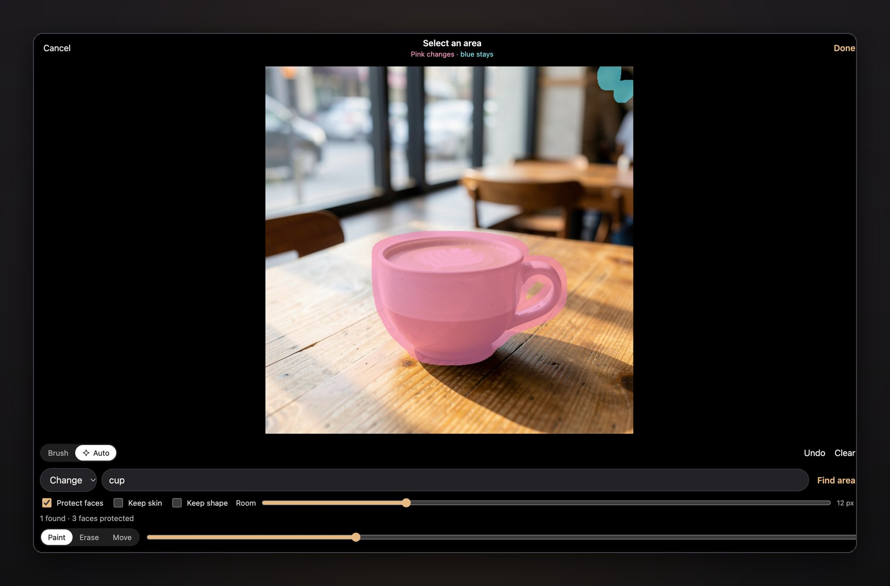
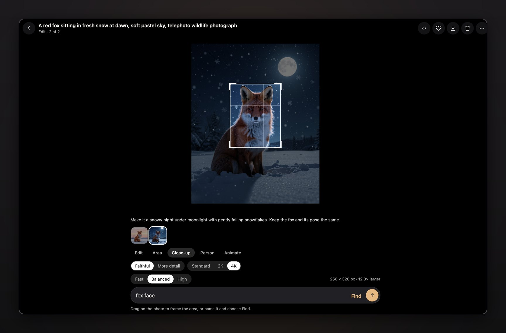
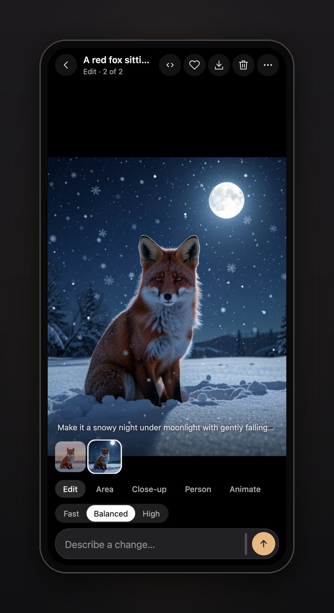

<p align="center">
  
</p>

<h1 align="center">LIS · Local Image Studio</h1>

<p align="center">
  <b>Create and edit images with AI on your own computer, privately, from your browser or your phone.</b><br>
  One-command install for Macs with Apple Silicon and Linux PCs with NVIDIA GPUs. No cloud, no account, no subscription.
</p>

<p align="center">
  <a href="docs/install-mac.md">Install on a Mac</a> ·
  <a href="docs/install-docker.md">Linux with Docker</a> ·
  <a href="docs/install-linux.md">Linux from source</a> ·
  <a href="docs/user-guide.md">User guide</a> ·
  <a href="docs/phone.md">Phone app</a>
</p>



Local Image Studio is a ready-to-use image studio built on **FLUX.2 Klein 9B**, **SAM 3** and
**ComfyUI**. Describe an image or a change in plain words and it is made on your own GPU. Your photos
and prompts never leave your home network. Use it from any browser on your computer, or install it on
your phone like an app and send photos to it from your gallery.

## Features

- **Create from text.** Fast, Balanced or High quality, 1–4 variations at once, square, portrait or
  landscape, up to 4K with local AI upscaling.
- **Edit with words.** "Make it a snowy night", "change the sofa to green velvet". Edits keep your
  photo's exact size, and the original is never changed.
- **Edit only an area.** Paint the area that may change, or let **SAM 3** find it from a word like
  `shirt` or `cup`. Everything outside the area stays pixel for pixel. Faces and skin can be protected
  automatically.
- **Close-up.** Frame part of a photo and get a detailed, enlarged version of it.
- **Person swap.** Replace a head or a whole person using another photo, with a preview of exactly
  which pixels may change.
- **Photo to video** (optional). Animate any image into a short clip with sound, using LTX-2.3.
- **Projects and history.** Every edit joins its project. Press and hold to compare with the parent
  or the original. Favorites, archive, search, bulk ZIP downloads, and a saved recipe (prompt, seed,
  settings, model versions) for every image.
- **Made for phones.** Installable app over your home Wi-Fi with HTTPS. Share photos from the gallery
  (Android) or a Shortcut (iPhone), and browse your library offline when you're away.
- **Gentle on your computer.** The model loads only when you make an image and is unloaded after 10
  idle minutes. Browsing never wakes it.

<table>
  <tr>
    <td width="50%"><br><sub><b>Compare</b> an edit with the photo it came from.</sub></td>
    <td width="50%"><br><sub><b>Area edits</b>: SAM 3 finds the object; the rest stays untouched.</sub></td>
  </tr>
  <tr>
    <td width="50%"><br><sub><b>Close-up</b>: frame a detail and enlarge it with new detail.</sub></td>
    <td width="50%"><br><sub><b>On your phone</b>: an installable app for your home network.</sub></td>
  </tr>
</table>

## Requirements

| | Mac | Linux PC |
| --- | --- | --- |
| Processor or GPU | Apple Silicon (M1 or newer) | NVIDIA GPU with 6 GB+ VRAM, driver 580+ |
| Memory | 24 GB recommended | 16 GB |
| System | macOS 14 or newer | x86-64 Linux, such as Ubuntu 22.04 or 24.04 |
| Free disk space | about 35 GB | about 40 GB |
| Tested on | MacBook Pro M5, 24 GB | RTX 3060 Laptop 6 GB, 16 GB RAM, Ubuntu 24.04 |

Nothing else needs to be installed first. The installer brings its own Python and verifies every
download. Docker is optional.

## Install

### Mac

Open **Terminal**, paste this line and press Return:

```bash
curl -fsSL https://raw.githubusercontent.com/aliarabbasi5155/local-image-studio/main/install.sh | bash
```

It downloads about 30 GB of models. When it finishes, your browser opens the studio and Terminal shows
your PIN. The [step-by-step Mac guide](docs/install-mac.md) walks through it with pictures.

### Linux with Docker

With [Docker Engine and the NVIDIA Container Toolkit](docs/install-docker.md#requirements):

```bash
git clone https://github.com/aliarabbasi5155/local-image-studio.git
cd local-image-studio
docker compose up -d
```

Then open <http://localhost:7878>. The PIN is in `studio-data/access-pin.txt`. See
[Run with Docker](docs/install-docker.md).

### Linux from source

```bash
sudo apt install git curl build-essential
git clone https://github.com/aliarabbasi5155/local-image-studio.git
cd local-image-studio
./install.sh
```

See [Install on Linux](docs/install-linux.md).

## Everyday use

The studio starts by itself when you log in. Open **<http://localhost:7878>** on the computer, or the
phone address the installer printed, and enter your PIN. To install it on your phone, see
[Use it on your phone](docs/phone.md).

```bash
make status    # what's running, the phone address and the PIN
make stop      # stop until the next login (make start to resume)
make update    # get the newest version
make help      # everything else
```

## Documentation

| | |
| --- | --- |
| [User guide](docs/user-guide.md) | Creating, editing, areas, close-ups, person swaps, video, sizes |
| [Use it on your phone](docs/phone.md) | Installing the app, sharing photos, offline library |
| [Install on a Mac](docs/install-mac.md) · [Linux](docs/install-linux.md) · [Docker](docs/install-docker.md) | Setup in detail |
| [Configuration](docs/configuration.md) | Where data lives, backups, PIN, ports, settings |
| [Troubleshooting](docs/troubleshooting.md) | Common problems and fixes |
| [How it works](docs/architecture.md) | Components and security model |
| [Performance](docs/performance.md) | Measured timings |
| [Models and licenses](docs/models-and-licenses.md) | What gets downloaded and under which terms |
| [Development](docs/development.md) | Tests, command line, ComfyUI, contributing |

## Responsible use

Editing tools that change people, like **Person swap**, can be misused. Only edit photos of people
who have agreed to it. Don't create images that deceive, harass or sexualize real people, or that
break the law where you live. The model licenses below also have their own use policies.

## License

The code in this repository is licensed under the [Apache License 2.0](LICENSE).

The models are downloaded from their publishers during installation and have their own licenses.
**FLUX.2 Klein 9B is under the [FLUX Non-Commercial License](https://huggingface.co/black-forest-labs/FLUX.2-klein-9B/blob/main/LICENSE.md)**,
so check it before any commercial use. See [Models and licenses](docs/models-and-licenses.md) for every
model, including the optional SNOFS adapter and video models.

## Acknowledgements

Built on [FLUX.2 Klein](https://github.com/black-forest-labs/flux2) by Black Forest Labs,
[ComfyUI](https://github.com/Comfy-Org/ComfyUI), [MFLUX](https://github.com/filipstrand/mflux) and
[MLX](https://github.com/ml-explore/mlx), [comfyui-flux2klein-mlx](https://github.com/tanis2000/comfyui-flux2klein-mlx),
[ComfyUI-GGUF](https://github.com/city96/ComfyUI-GGUF), [SAM 3](https://github.com/facebookresearch/sam3) via
[sam3.cpp](https://github.com/PABannier/sam3.cpp), [Real-ESRGAN](https://github.com/xinntao/Real-ESRGAN),
[LTX-2](https://github.com/Lightricks/LTX-2) and [ltx-2-mlx](https://github.com/dgrauet/ltx-2-mlx), and the
quantized models from [mlx-community](https://huggingface.co/mlx-community) and [Unsloth](https://huggingface.co/unsloth).
