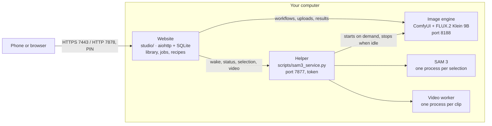

# How it works

Local Image Studio has three parts. Only the image engine uses the GPU, and it runs only while there is
work.

- **Website** (`studio/`): a small aiohttp server with a plain HTML/JS front end and no external services
  or CDNs. It owns the library in `studio-data/`: SQLite for projects, jobs and recipes, plus the image
  files. It turns each request into a ComfyUI workflow, submits it and post-processes the result:
  blending masked edits back into the original, color matching, close-up compositing and thumbnails.
- **Helper** (`scripts/sam3_service.py`): a login service (launchd or systemd, or the engine container
  under Docker). It starts ComfyUI when a job arrives and stops it after 10 idle minutes, never while
  ComfyUI's queue has work. It also runs SAM 3 for automatic selection and the video worker, each as a
  separate process that exits when done, so their memory is freed. Every request needs the token in
  `runtime/sam3-token.txt`.
- **Image engine**: a pinned ComfyUI. On macOS it runs FLUX.2 Klein through MFLUX/MLX on the Apple GPU,
  with patches (`patches/`) that release the text encoder after encoding and the transformer before VAE
  decoding. This cut an 8-bit 1024 × 1024 image from 184 s to 76 s with identical pixels. On NVIDIA it
  uses ComfyUI-GGUF with low-VRAM offloading and a one-time retry when the GPU runs out of memory.

## Where things run

| | Website | Helper and engine |
| --- | --- | --- |
| macOS, standard install | launchd service | launchd service, Apple GPU |
| macOS with `make start-docker` | Docker Desktop | launchd service (Docker can't use the Apple GPU) |
| Linux, source install | systemd user service | systemd user service, NVIDIA GPU |
| Linux, `docker compose` | container | container with the GPU (NVIDIA Container Toolkit) |

## Jobs survive restarts

The website saves each ComfyUI prompt ID before submitting it. After a restart, it reconnects to
queued, running and finished work instead of submitting it again. If the engine lost a job, the job
shows an error with **Reuse settings** rather than silently running it twice. Deletions are staged so
an interrupted deletion is completed or rolled back on the next start.

## Every result keeps its recipe

Each image's recipe records the prompt, seed, quality, sizes, masks, model sources and revisions,
adapter and runtime versions. It is stored in the database and in the JPEG's comment. **Reuse
settings** and **Download recipe** use it.

## Security model

- The studio is meant for your home network. Don't expose ports 7878 or 7443 to the internet.
- A random six-digit PIN protects the website. Sign-in attempts are rate-limited, and cross-origin
  requests that change anything are rejected.
- Phones connect over HTTPS using a home certificate authority created on your computer. Its X.509
  name constraints limit it to `.local` names, `localhost` and private IP ranges, and its key stays in
  `runtime/home-ca/`. The website only sees the public certificate and its own server key. Once HTTPS
  is set up, plain HTTP serves other devices only the setup page, so the PIN never crosses the network
  unencrypted.
- The helper and engine listen on `127.0.0.1` only (inside the Compose network in Docker), and the
  helper requires a token readable only by your user.
- Uploads are limited in size and pixel count and are decoded before use.
