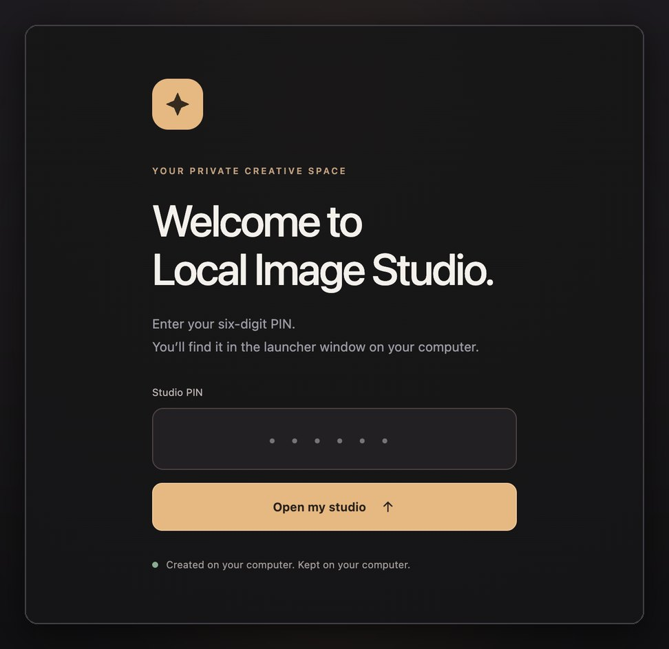

# Install on a Mac

This guide assumes no technical background. Installing takes about 10 minutes of your time, plus the
download of about 30 GB of AI models, which can take an hour or more on a slow connection.

## What you need

- A Mac with **Apple Silicon** (M1 or newer). To check, open  → **About This Mac**: the
  **Chip** line should say Apple M1, M2, M3, M4 or M5.
- **macOS 14 (Sonoma) or newer.**
- **24 GB of memory or more** is recommended. Local Image Studio was tested on an M5 with 24 GB.
  Macs with 16 GB are untested; if images fail there, use **Fast** quality.
- **About 35 GB of free disk space.**

You don't need Docker, Homebrew or Python. The installer sets up everything it needs inside its
own folder.

## 1. Open Terminal

Press **⌘ Space**, type **Terminal** and press **Return**. A window with a text prompt opens.

## 2. Paste the install command

Copy this line, paste it into Terminal with **⌘ V**, and press **Return**:

```bash
curl -fsSL https://raw.githubusercontent.com/aliarabbasi5155/local-image-studio/main/install.sh | bash
```

The studio is installed in a folder named **LocalImageStudio** in your home folder.

**If a window asks you to install the "command line developer tools"**, click **Install** and wait
for it to finish. Then paste the same command again. Apple's tools are needed to build one small
component.

## 3. Wait for the download

The installer explains each step as it goes. Most of the time is spent downloading the image model
(FLUX.2 Klein 9B, in a faster 4-bit and a more detailed 8-bit version). You can keep using your Mac
in the meantime. If the download is interrupted, paste the command again: it continues where it
stopped.

When it finishes, your browser opens the studio and Terminal shows something like this:

```text
Local Image Studio is ready
  On this computer:          http://127.0.0.1:7878
  On your phone (same Wi-Fi): http://192.168.1.20:7878
  The phone's first visit helps it trust this computer, then opens the installable app at https://192.168.1.20:7443
  Your PIN: 123456
```

## 4. Sign in

Enter the six-digit **PIN** from Terminal. It stays the same until you change it (see
[Configuration](configuration.md#change-the-pin)).



Your first image takes a little longer while the model loads. After that, Fast images take about
20 seconds and High about a minute on an M5.

## Every day after that

You don't need Terminal again. The studio starts by itself when you log in to your Mac and waits
quietly. It loads the AI model only when you make an image, and frees the memory after 10 idle
minutes.

- **On your Mac**, open **<http://localhost:7878>**. Bookmark it. You can also double-click
  **Local Image Studio.command** in the LocalImageStudio folder: it starts the studio if needed
  and opens your browser.
- **On your phone**, see [Use it on your phone](phone.md).
- **Forgot the PIN?** Double-click **Local Image Studio.command**; it prints the PIN again.

Keep your Mac awake and logged in while you make images from your phone.

## Optional extras

Run these in Terminal from the studio folder (type `cd ~/LocalImageStudio` first):

| Command | What it adds |
| --- | --- |
| `./install.sh --with-video` | Photo to video (about 25 GB). Needs FFmpeg: install [Homebrew](https://brew.sh), then `brew install ffmpeg`. |
| `./install.sh --with-snofs` | The SNOFS style adapter (1.1 GB), a third-party add-on under a personal-use license. See [Models and licenses](models-and-licenses.md#snofs-adapter). |

## Update, stop or remove

From the studio folder in Terminal:

| Command | What it does |
| --- | --- |
| `make update` | Gets the newest version and finishes any new setup steps. Your library is kept. |
| `make status` | Shows whether the website, helper and engine are running. |
| `make stop` | Stops everything until your next login or `make start`. |
| `make uninstall` | Stops automatic startup. Your images (`studio-data/`) and models stay. |

To remove Local Image Studio completely, run `make uninstall`, then move the **LocalImageStudio**
folder to the Trash. Back up `studio-data/` first if you want to keep your images.

## Already use Git?

```bash
git clone https://github.com/aliarabbasi5155/local-image-studio.git
cd local-image-studio
./install.sh
```

Prefer to run the website in Docker Desktop? Add `--docker-website`. The image engine always runs
natively, because Docker on macOS can't use the Apple GPU. See [Docker](install-docker.md#macos-website-in-docker-desktop).

Something not working? See [Troubleshooting](troubleshooting.md).
