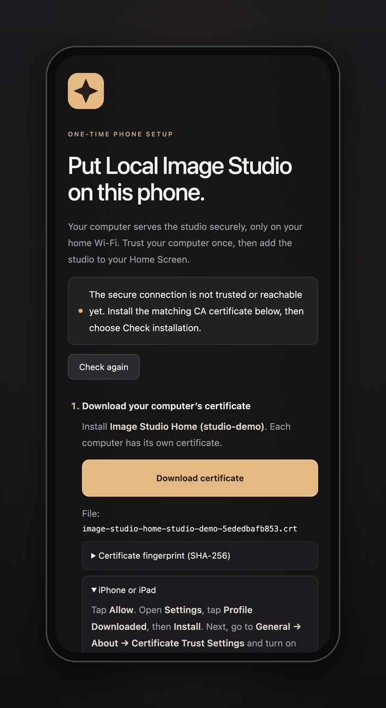

# Use it on your phone

Any phone on the same Wi-Fi can use the studio in its browser. For the best experience, install it as
an app: it opens full screen, accepts photos from the Share menu and keeps a copy of your library for
when you're away from home.

Everything stays on your network. Don't forward ports 7878 or 7443 on your router.

## Open it in the phone's browser

Open the **On your phone** address that the installer printed, for example `http://192.168.1.20:7878`.
`make status` (or double-clicking **Local Image Studio.command** on a Mac) shows it again, and the
**Connect** button in the studio shows it too.

## Install it as an app

An installable web app needs a secure (HTTPS) connection. Local Image Studio creates a small
certificate authority for your computer, and each phone trusts it once:

1. On the phone, open the `http://…:7878` address. It shows a one-time setup page.
2. Tap **Download certificate**. Check that the computer name and file name match the setup page.
   - **iPhone / iPad:** tap **Allow**, then **Settings → Profile Downloaded → Install**. Then turn on
     full trust in **Settings → General → About → Certificate Trust Settings → Image Studio Home**.
   - **Android:** open **Settings**, search for **CA certificate**, and install the downloaded file as a
     **CA certificate** (not a Wi-Fi or VPN certificate). Then restart Chrome.
3. Tap **Check installation**. A red certificate warning means trust isn't set up yet; opening the page
   past the warning is not enough.
4. Sign in with your PIN, then **Share → Add to Home Screen** (iPhone) or **⋮ → Add to Home screen →
   Install** (Android).

The certificate authority can only vouch for `.local` names, `localhost` and private addresses such
as `192.168.x.x` (enforced with X.509 name constraints), so even its key can't impersonate a real
website. The key never leaves your computer's `runtime/home-ca/` folder.

### Keep the address stable

The installed app remembers the address it was installed from. Reserve your computer's address in
your router (often called *DHCP reservation*) so it doesn't change. On a Mac, iPhones can also use
`https://<your-mac-name>.local:7443`, which survives address changes.

If the address changes, run `make start` (or double-click the launcher). It issues a new certificate
for the new address immediately; phones keep trusting the same authority.

## Away from home

The installed app keeps a copy of your library on the phone, including full-size images and finished
clips, and keeps it up to date while it can reach your computer. Away from home it opens that copy:
you can browse, search, compare, favorite, archive, delete, download and play clips. Changes wait on
the phone and sync when you're back. Making or editing images needs your computer.

**Lock studio** in the menu removes the copy from the phone. An ordinary browser tab keeps no copy.

## Send photos from the Share menu

Open **Use on your phone → Set up photo sharing** in the studio for a step-by-step guide with your
exact address.

- **Android (Chrome):** after installing the app, choose **Share → Image Studio** in Photos, Gallery
  or Files. Unlock the studio and choose **Import photos**. Each photo becomes a new project. Up to
  10 photos (20 MB each) can wait for up to 24 hours if your computer isn't reachable.
- **iPhone / iPad:** Safari doesn't support sharing to web apps, so the guide walks you through a
  **Send to Image Studio** shortcut in Apple Shortcuts. It converts HEIC to JPEG, uploads the photo
  with your PIN in a header (never in the address) and opens the new project. Keep the shortcut
  private, and update it if your PIN or address changes.

## Reset the phone setup

To start over with a new certificate authority, delete `runtime/home-ca/` and `runtime/tls/` (on
Docker: `runtime/docker/home-ca/` and `runtime/docker/tls/`), run `make start` (or restart the
containers), and trust the new certificate on each phone. On iPhone, remove the old one under
**Settings → General → VPN & Device Management**.
