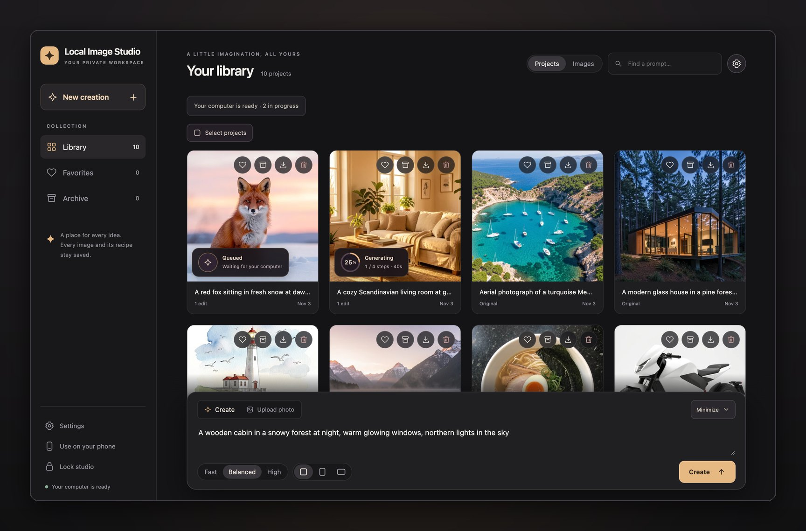
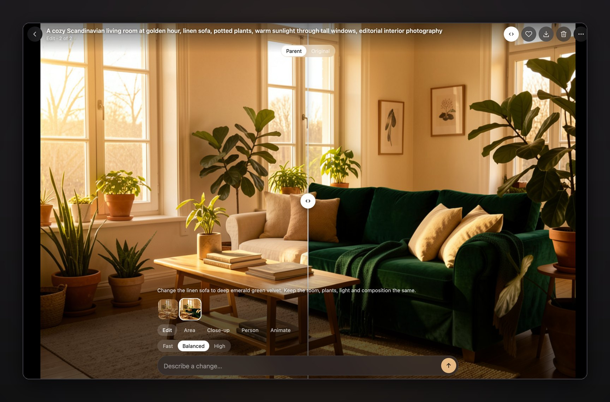
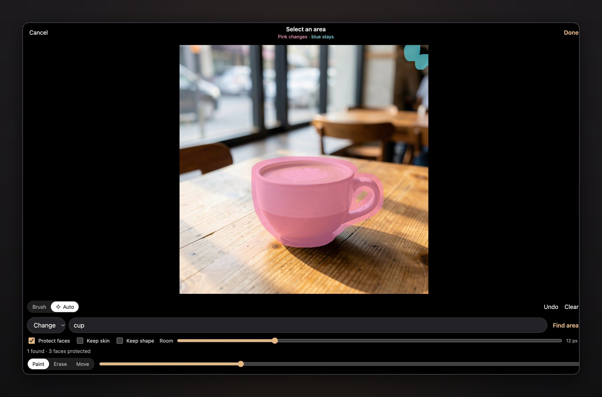
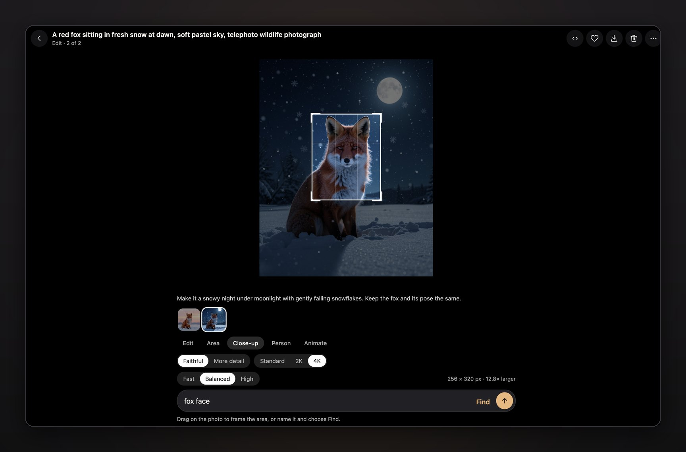

# User guide

Local Image Studio keeps your work in **projects**. Each new image or uploaded photo starts one, and
every edit, close-up and clip made from it joins the same project, so you can always step back through
its history and compare.

## Create an image

Describe the image in the panel at the bottom of the library, choose a **quality** and a **shape**
(square, portrait or landscape) and press **Create**. Each image takes 20–90 seconds depending on
quality and your computer; the card shows the engine's real progress.

| Quality | Model | Square | Portrait | Landscape |
| --- | --- | --- | --- | --- |
| Fast | Klein 9B, 4-bit | 512 × 512 | 512 × 640 | 768 × 512 |
| Balanced | Klein 9B, 8-bit | 768 × 768 | 640 × 800 | 960 × 640 |
| High | Klein 9B, 8-bit | 1024 × 1024 | 832 × 1040 | 1152 × 768 |

Start with **Fast** to try ideas, then repeat the best one at Balanced or High. **Settings** (the gear)
can make 1–4 variations at once and choose 2K or 4K output. Every image gets a random seed; **Reuse
settings** repeats one, including its seed.

**Upload photo** adds your own PNG, JPEG or WebP (up to 20 MB and 16 megapixels) as a new project.
Convert HEIC photos to JPEG first.

## The viewer

Open a project to see its photo full screen with the tools floating over it.

- **Move around:** swipe, or use the arrow keys; past the last image, you continue into the next
  project (**Shift + arrow** jumps between projects). Tap the photo, or press **H**, to hide the controls.
- **Zoom:** pinch or double-tap, then drag to pan.
- **Compare:** press and hold the photo to see what it came from. The compare button shows a split you
  can drag, comparing with the **Parent** (previous version) or the **Original**.
- **The strip** shows every image and clip in the project, including ones still being made.
- **Favorite, download, delete** are the small buttons at the top. Downloads are full-size JPGs. **⋯**
  holds **Reuse settings**, **Copy prompt**, **Download recipe**, **Archive project** and **Delete
  whole project**.

## Edit with words

In the viewer, choose a quality, describe the change ("make it a snowy night", "change the sofa to
green velvet") and send. The result keeps the photo's size and shape, appears in the strip and opens
when it's ready. The original is never changed.

AI edits can also change details you asked to keep, so check the result. To limit what can change,
edit an area instead.

## Edit only an area

Choose **Area** to paint where the change is allowed. Every pixel outside the painted area is copied
from the original into the result.

1. **Paint** over what may change, including shadows, and leave a little room around the object.
   **Erase**, **Undo** and **Clear** fix mistakes; pinch to zoom.
2. Or choose **Auto** and let SAM 3 find it for you:
   - **Change something existing:** type a short name like `shirt`, `cup` or `hair` and choose **Find
     area**. If several things match, pick one or **Select all**. **Extra room** gives new shapes space.
   - **Move something:** find it, then **Draw destination** to drag a box where it should go.
   - **Add something new:** **Draw placement** to drag a box where it should appear.
3. Choose **Done**, describe the change and send.

**Protect detected faces** is on for automatic selections: blue areas are copied exactly and the brush
can't enter them. For clothing, **Keep visible skin** protects necks, arms and hands, and **Keep body
shape** guides the model to keep the same silhouette. Detection can miss things, so check the preview.

**Settings → Area edits** controls the working size (smaller is faster), how much surrounding context
the model sees, edge blending, and color matching with the surroundings.

## Close-up

Choose **Close-up** to make a detailed image of part of a photo. Draw or move the frame, or type a
subject ("face", "hand") and choose **Find**.

**Faithful** keeps closely to the original's structure; **More detail** lets the model add detail more
freely. **Standard** stays within the quality's size; **2K** and **4K** set the saved size, with the
model's detail upscaled and blended in. The added texture is plausible detail, not recovered truth.
**Compare** shows a plain enlargement of the same frame.

## Swap a person

Choose **Person** to put someone from another photo into this one. The photo on screen supplies the
scene, pose, head angle and gestures. **Choose a person** from your library or **Upload** a clear
photo of one person.

| Mode | What changes | What the original keeps |
| --- | --- | --- |
| **Head** | Face, ears and hair | Body, outfit, head angle, expression and scene |
| **Whole person** | The entire person, including build and outfit | Position, pose, gestures and objects they hold |

Send once to preview: pink marks every pixel that may change, and everything else is copied from the
original. If a held object (like a glass) is inside the pink area, name it under **Keep a held object**
and preview again. Then send to swap. Likeness is a model prediction, not a guarantee.

Only use photos of people who have agreed to it. See [Responsible use](../README.md#responsible-use).

## Photo to video

With [video installed](install-mac.md#optional-extras), choose **Animate** on any image. Describe the
motion and pick about 2, 4 or 6 seconds. The clip (MP4 with sound) joins the project's strip. **Match
photo** keeps the photo's exact size; **Preview** (in **Settings → Videos**) is smaller and faster. A
two-second clip took about 4 minutes on an M5. Start short; the model may move the camera even if you
ask it not to.

## Sizes and upscaling

**Settings** chooses the size and resizing separately for edits and new images:

- **Size:** Preset (the quality table above), Match the photo, **2K** (2048 px on the long edge) or
  **4K** (4096 px).
- **Resizing:** *Resize or AI upscale* makes large images on a smaller canvas and enlarges them with the
  local Real-ESRGAN upscaler. *None · native size* saves exactly what the model made. *None · full size*
  generates directly at the chosen size, which is slower and uses more memory.

Edits default to the photo's own size. Each image's details show both its saved size and the size it
was generated at.

## Organize

- **Favorites** collects starred images; a library card's heart stars a whole project.
- **Archive** hides a project until you restore it.
- **Select** in the library to favorite, download as a ZIP of JPGs, or delete many at once.
- **Search** finds projects by prompt.
- Deleting is permanent; it asks first.

## Timing and status

Estimates such as **≈ 40 s** come from your own recent runs with the same settings; with no similar
run yet, the studio shows no guess. Tap the status strip above the library for your computer's free
memory, the queue, recent image times and free disk space.

The first image after the engine has slept takes longer while the model loads. Browsing the library
never wakes the engine.

## The SNOFS adapter

If you installed the optional [SNOFS adapter](models-and-licenses.md#snofs-adapter), **Settings →
Style** turns it on or off for creations and edits. Person swaps and close-ups never use it. When it
isn't installed, the setting is hidden.
