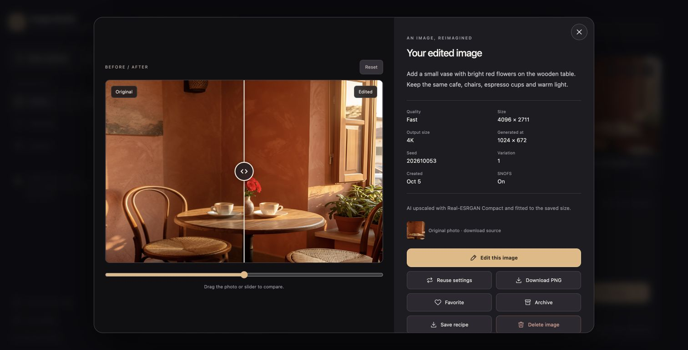

# Image Studio

A small website for the existing FLUX.2 Klein / SNOFS setup. Use it on this Mac
or a phone on the same Wi-Fi. It includes image creation and editing, 1–4
variations, quality presets, exact original-size edits, 2K/4K output, Favorites,
a reversible Archive, and saved recipes.
Images can also be permanently deleted after confirmation.

## Open it again

1. Open **Docker Desktop** and wait until it is running.
2. Double-click **Start Web Studio.command** in the project folder.
3. Enter the six-digit PIN printed in the launcher. It is also saved in
   `studio-data/access-pin.txt` and stays the same after a restart.
4. On this Mac, open **http://localhost:7878**. On your phone, open the
   **On your phone** address printed by the launcher while using the same Wi-Fi.
   The **Connect** button in the website also shows that address.

You can close the launcher Terminal window and browser. Keep the Mac awake and
Docker Desktop running while making images. After restarting the Mac, launch
the studio again. If the router changes the Mac's address, the next launch
prints the new phone address. Your phone can add the page to its home screen
from the browser's Share/menu controls.

## Make and edit images

- **Minimize the bottom panel:** tap **Minimize** beside the Create/Edit tabs to
  make room for browsing your images. Tap **Expand** to bring the controls back.
  Your prompt, chosen photo and settings stay in place, and that browser remembers
  whether the panel was minimized after a refresh. Choosing Create, Edit image,
  New creation, Edit this image or Reuse settings opens it automatically.
  Ctrl/Cmd + Enter opens a minimized panel; when expanded, it submits your prompt.
- **Create:** describe what you want, choose quality, shape, output size and 1–4 variations,
  then tap **Create image**. Each variation uses a different seed and saves as
  it finishes. Images run one at a time to fit this Mac's memory.
- **Edit:** choose **Edit image**, upload a PNG, JPEG or WebP photo, and describe
  the change. Or open a library image and choose **Edit this image**.
  **Match original** keeps the photo's exact width and height. Tell the
  model what should stay the same, for example: “Make the coat red. Keep the
  same face, scarf and background.” Your source remains saved.
- **Compare an edit:** open an edited image to see **Before / after**. The original
  is on the left and the edited result is on the right. Drag the divider, swipe
  horizontally on the photo, or move the slider underneath. **Reset** returns to
  a half-and-half view. With the slider focused, arrow keys adjust the split;
  Home shows the full edit and End shows the full original. This also works for
  earlier saved edits. Both photos fit the same viewing area without stretching
  or cropping, including when an edit has a different size or shape.

  
- **Heart:** adds an image to Favorites. Tap it again to remove the favorite.
- **Download:** tap the down-arrow button at the bottom left of any thumbnail,
  then choose **PNG** or **JPG**. Both download at the full saved dimensions.
  It works in Library, Favorites and Archive without opening the image details;
  the details also have separate **Download PNG** and **Download JPG** buttons.
  PNG includes the embedded settings and workflow. JPG is a high-quality
  sharing copy (quality 95) without those embedded settings. Your saved PNG,
  editing source and studio recipe remain unchanged. Any transparent areas
  become white in JPG. Choose **Save recipe** to download the settings separately.
- **Archive:** moves an image out of the library. Open Archive and choose
  **Restore** to bring it back. Its image, source and settings are kept.
- **Delete:** tap the trash icon on an image, or open it and choose **Delete
  image**. Check the preview, then choose **Delete permanently**. **Keep image**
  cancels. This removes that result, its thumbnail and saved settings from the
  website, including Favorites and Archive. There is no restore after deletion;
  use Archive when you may want the result again. Other images and saved editing
  source photos are kept, so later edits and reused recipes remain usable.
- **Open an image:** download its PNG or JPG, view its settings, download the recipe,
  reuse its settings, or make another edit. **Reuse settings** restores the
  prompt, seed, quality, shape, output size, SNOFS and editing source for that result.
- **Stop:** stops only that variation. Other queued variations can finish.

AI edits can also change details you asked to keep; inspect the result. The
upload accepts photos up to 20 MB and 16,777,216 pixels (including 4096 × 4096).
Convert HEIC photos to
JPEG or PNG before uploading.

## Output size

Choose **Output size** before creating or editing. The line below the controls
shows the dimensions that will be saved.


| Choice | Saved image |
| --- | --- |
| Preset | The quality/shape dimensions in the table below |
| Match original | Exactly the editing photo's width and height, including odd dimensions |
| 2K | 2048 pixels on the longest edge |
| 4K | 4096 pixels on the longest edge |

In Edit mode, Match original, 2K and 4K keep the source photo's aspect ratio.
For example, a 751 × 497 photo saves as 751 × 497, 2048 × 1355 or 4096 × 2711.
Shape then shows **Original photo**. In Create mode, 2K/4K use the chosen shape;
a square 4K image is 4096 × 4096. Choose Preset when you want to change an edit
to a preset square, portrait or landscape canvas.

Large outputs are generated on a smaller canvas, enhanced with the local
**Real-ESRGAN Compact** AI upscaler, then fitted to the exact saved dimensions
without cropping. The generation canvas stays near one megapixel to fit this
Mac's memory. A 4K output uses at least 1024 pixels on the generation canvas's
longest edge, even with Fast. These are AI-upscaled outputs. An image's details
show both **Size** and **Generated at**; its PNG and saved recipe retain the
generation dimensions and upscaler settings. **Reuse settings** restores the
output-size choice, and **Edit this image** starts with Match original.

Match original supports up to 16,777,216 pixels and 8192 pixels per side.
Original-shape output supports aspect ratios from 1:32 to 32:1. Your saved
source remains unchanged; the AI can change details while editing or enhancing.

## Quality

| Preset | Model | Square | Portrait | Landscape |
| --- | --- | --- | --- | --- |
| Fast | Klein 9B, 4-bit | 512 × 512 | 512 × 640 | 768 × 512 |
| Balanced | Klein 9B, 8-bit | 768 × 768 | 640 × 800 | 960 × 640 |
| High | Klein 9B, 8-bit | 1024 × 1024 | 832 × 1040 | 1152 × 768 |

These dimensions apply to **Preset** output. Start with **Fast** to explore
ideas, then use Balanced or High for more detail. At larger output sizes the
generation canvas also depends on the requested dimensions, so Balanced and
High can share a canvas size. Fast uses the 4-bit model; Balanced and High use
the 8-bit model.
All presets use the distilled model's four steps and guidance 1.0. SNOFS is
enabled by default and can be switched off. The optional fixed seed makes it
easy to revisit the same settings; random seed gives a fresh starting point.

Two real Fast square creations with SNOFS took about 21 and 19 seconds on this
Mac, and a Fast square edit took about 30 seconds. Larger images and other
applications change timing. These are measured examples, not guarantees.

With Fast and SNOFS, an exact 751 × 497 edit took **27.41 seconds**, a 2K square
creation took **20.01 seconds**, and a 4096 × 2711 edit took **46.96 seconds**
from worker submission to saved result. These include AI upscaling and exclude
time waiting in the queue. See [the measured runs](../benchmarks/20261005-output-sizes.json).

## Where everything is saved

`studio-data/` is the persistent library, outside the container:

| Path | Contents |
| --- | --- |
| `studio.sqlite3` | Jobs, recipes, favorite/archive state and sign-in sessions |
| `images/` | Original generated PNGs, with embedded recipe and ComfyUI workflow |
| `uploads/` | Saved editing sources, normalized to PNG |
| `thumbs/` | Small gallery previews |
| `access-pin.txt` | Your local access PIN |

Restarting or rebuilding the container preserves this directory. To back up the
library, wait for generations to finish, stop the website with the command
below, then copy the **whole studio-data folder**. Start it again with the
launcher. Git ignores your images, PIN, sessions and model weights.

The website PIN controls access to the library and generation API. This setup
serves HTTP for your trusted local network; the PIN is not encrypted in transit.
Keep access on your local network.

Delete removes the website's copy. Previously downloaded files, backups and
ComfyUI's engine copies under `outputs/web-studio/` remain separate. Deletion
stages the website files and removes the image/job records together; after an
interrupted deletion, the next website start restores an uncommitted deletion
or finishes a committed one. It does not put deleted results back in Archive.

## Docker and developer commands

The launcher starts/reuses ComfyUI natively on the Mac, then builds and runs the
website in Docker. Docker Desktop's documented GPU support does not provide
Apple Metal GPU access to Linux containers, so the MLX engine stays native.
The container reaches it through `host.docker.internal`; the engine itself stays
on loopback port 8188. See [Docker GPU support](https://docs.docker.com/desktop/features/gpu/)
and [host networking](https://docs.docker.com/desktop/features/networking/networking-how-tos/).
Existing model files are reused and are not copied into the Docker image.
The web launcher automatically installs the roughly 5 MB upscaler from the
[official Real-ESRGAN release](https://github.com/xinntao/Real-ESRGAN/releases/tag/v0.2.5.0),
checks its pinned SHA256, and makes it available to native ComfyUI. Its source
is recorded in `config/upscaler.json`; the weights stay in `models/upscale/`.
Future launches reuse the verified file without downloading it again. Upscaling
runs in native ComfyUI alongside the MLX engine.

From the project root:

```bash
# Start engine + Docker website, without opening a browser
./Start\ Web\ Studio.command --no-browser

# Stop the website (keeps the library and native engine)
docker compose --env-file runtime/studio-docker.env stop

# Inspect website logs
docker compose --env-file runtime/studio-docker.env logs --tail 100

# Run the website directly in this project's Python environment
./Start\ Web\ Studio.command --native

# API, persistence, cancellation and engine integration checks
make test-studio
make check
```

Use one website instance per library; stop Docker before switching to native
mode. Native mode uses the same data and PIN. It requires the dependencies in
`studio/requirements.txt`, already available in this checkout's `.venv`.
For a fresh checkout, install the model/runtime setup described in the root
README, download the optional 4-bit model and SNOFS, then use the web launcher.

The Docker environment is generated in `runtime/studio-docker.env`, including
the absolute host model path and your UID/GID for the data mount. Compose can
also be run manually with that file. `COMFY_URL`, `ENGINE_PROJECT_ROOT`,
`STUDIO_DATA` and `STUDIO_LAN_URL` configure the Python service.

The worker saves each ComfyUI prompt ID before submitting and recovers existing
queued/running/completed jobs after a website restart. If the engine loses a
job's history, it shows an error with **Reuse settings** rather than silently
duplicating the generation. No external services or CDNs are required by the
website. The existing model and adapter license terms still apply.
