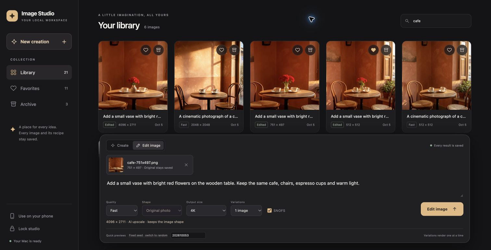

# Image Studio

A small website for the existing FLUX.2 Klein / SNOFS setup. Use it on this Mac
or a phone on the same Wi-Fi. It includes image creation and editing, 1–4
variations, quality presets, exact original-size edits, 2K/4K output, Favorites,
a reversible Archive, and saved recipes.
Images can also be permanently deleted after confirmation.

## Photo to video

Choose **Photo to video · Your clips** above the library to upload a photo,
or open any completed project image and choose **Animate photo**. Describe the
motion, choose landscape (768 × 512), portrait (512 × 768), or square (512 × 512),
then generate a clip of approximately 2 or 4 seconds at 24 fps. The model fits the
photo to the selected shape, which can crop its edges. Start with a short clip.
Use a fixed seed to reuse the same settings. Every clip has MP4 playback, download,
and a separate settings JSON. The video library shows the latest 100 jobs.

The optional backend is **LTX-2.3 distilled 1.1, Q4, MLX**, with block streaming
for this 24 GB Mac. The runtime is a community Apple Silicon port; exact runtime,
model and Gemma text-encoder revisions are recorded in `config/video.json`.
Quality and speed depend on the source photo, motion and available memory.
These conservative presets are not a promise of real-time generation.

The first real API check on this M5/24 GB Mac produced a 512 × 512 clip with
49 frames at 24 fps (2.04 seconds) in **223.52 seconds end to end**. It decoded
successfully as H.264 video with AAC audio; sampled frames contained the lake
scene and motion. The model introduced some camera movement despite a static-camera
prompt, so exact framing/motion adherence is not guaranteed. This one short square
clip does not establish timings or quality for the larger/longer presets.
See [the recorded check](../benchmarks/video-check.json).

One-time setup, **on the Mac, outside Docker**:

```bash
brew install ffmpeg
make setup-video
```

Setup creates `runtime/ltx-2-mlx/.venv`, uses the upstream frozen dependency lock,
and downloads only the needed distilled model files plus the text encoder into
`models/`. It does not change the image engine's Python environment. Downloads
need internet and substantial disk space; rerunning setup resumes partial files.
`--runtime-only` installs dependencies without weights. The completion marker is
written only after both model downloads finish. Inference uses local files with
Hugging Face offline mode enabled. The model's downloaded license and the text
encoder's model terms apply; runtime MIT licensing does not replace model terms.

After updating an existing installation, finish image/selection work and restart
the native helper, then rebuild/reopen the website using its usual launcher:

```bash
launchctl kickstart -k "gui/$(id -u)/com.localimagestudio.native"
./Start\ Web\ Studio.command --no-browser
```

Videos share Studio's GPU lock with image generation and automatic selection.
Before loading LTX, the helper stops its own idle ComfyUI process to free model
memory. It refuses to interrupt a busy queue or a manually started ComfyUI engine.
The next image wakes ComfyUI again. Avoid submitting directly to ComfyUI during
video generation. The video inference process exits after every clip. Cancel
disconnects the helper request and terminates inference; closing the dialog or
browser lets the job continue. A Studio restart marks an interrupted job failed
instead of silently generating it twice; queued jobs resume.

Clips and independent source copies live in `studio-data/videos/`; their jobs
and recipes live in the existing SQLite database. Back up the whole data folder.
Video source copies are limited to a 1536-pixel long edge for bounded transfer
and conditioning memory; the library's original photo keeps its dimensions.
Deleting an image/project does not delete its independent videos. Video deletion
is not currently exposed in the UI. Diagnostic output from the latest native
generation is in `runtime/video-inference.log`. The existing PIN and HTTPS rules
also protect videos, MP4 range requests and settings downloads.

For a real end-to-end check after setup, run `.venv/bin/python scripts/check_video.py`.
It submits the bundled lakeside example through the authenticated API, downloads the
result, checks frame count/dimensions/duration and decodes the MP4 with FFmpeg.
It writes `benchmarks/video-check.json` and an MP4 under `outputs/`; it also creates
a photo project and clip in the selected Studio instance. Use `--url` and
`--pin-file` to target a separate test library.

References: [MLX runtime](https://github.com/dgrauet/ltx-2-mlx),
[Q4 model pack](https://huggingface.co/dgrauet/ltx-2.3-mlx-q4),
[LTX-2](https://github.com/Lightricks/LTX-2).

## Open it again

1. Open **Docker Desktop** and wait until it is running.
2. Double-click **Start Web Studio.command** in the project folder.
3. Enter the six-digit PIN printed in the launcher. It is also saved in
   `studio-data/access-pin.txt` and stays the same after a restart.
4. On this Mac, open **http://localhost:7878**. On your phone, open the
   **On your phone** address printed by the launcher while using the same Wi-Fi.
   The **Connect** button in the website also shows that address.

The first launch installs a small Mac helper that starts automatically when you
log in. After restarting, let Docker Desktop start and open the website: submitting
an image wakes the engine automatically. It stops after 10 minutes without work,
releasing its model memory. Browsing the library does not wake it. The first image
after sleeping takes a little longer while the engine and model load.
You can close the launcher Terminal window and browser. Keep the Mac awake and
Docker Desktop running while making images. If the router changes the Mac's address, the next launch
prints the new phone address.

## Install it on your phone

The studio is an installable app (PWA) that only works on your home network. It
needs HTTPS, so the launcher creates a small certificate authority for this Mac
the first time it runs. Each phone trusts it once:

1. On the phone, open the **On your phone** address (`http://…:7878`). It shows
   a one-time setup page.
2. Tap **Download certificate**.
   - **iPhone/iPad:** tap **Allow**, then **Settings → Profile Downloaded →
     Install**. Then turn it on in **Settings → General → About → Certificate
     Trust Settings → Image Studio Home**.
   - **Android:** open **Settings**, search for **CA certificate**, choose
     **Install anyway**, and pick `image-studio-home.crt`.
3. Return to the setup page. It opens the secure studio at `https://…:7443`
   as soon as the phone trusts your Mac.
4. Sign in with your PIN, then **Share → Add to Home Screen** (iPhone) or
   **⋮ → Install app** (Android).

The installed app opens full screen, keeps its own sign-in, and shows its shell
with a "Can't reach your Mac" message when you are away from home. It never
caches the Mac's images or library; incoming Android shares are temporarily
kept on the phone until imported, discarded, or expired after 24 hours. Once HTTPS is ready, phones can only reach the
setup page over plain HTTP, so the PIN never crosses the Wi-Fi unencrypted.
This Mac keeps using **http://localhost:7878**, which browsers already treat as
secure; Chrome and Edge can install the app there too.

The installed app remembers its address. Reserve the Mac's address in your
router (DHCP reservation) so it stays the same. iPhones can instead use
`https://<your-mac>.local:7443`, which survives address changes; the launcher
includes the Mac's `.local` name in the certificate. After an address change,
run the launcher again: it reissues the certificate, and the website uses it
immediately without a restart. Phones keep trusting the same authority.

The authority is limited (with X.509 name constraints) to `.local` names,
`localhost` and private addresses (10.x, 172.16–31.x, 192.168.x, 127.x), so even
its private key cannot vouch for a real website. The key stays in
`runtime/home-ca/`; the website only sees the public certificate and its own
server certificate in `runtime/tls/`. To start over, delete both folders, run
the launcher, and trust the new certificate on each phone (remove the old one
under **Settings → General → VPN & Device Management** on iPhone).

## Send photos from the phone's Share menu

Open **Use on your phone → Set up photo sharing** for the guide and the exact
upload address for your phone.

**Android (Chrome):** install the secure studio, then open it once to update
the service worker. In Photos, Gallery or Files choose **Share → Image Studio**.
Unlock the studio and choose **Import photos**. Each photo becomes a new project;
the last imported photo opens ready to edit. Up to 10 PNG, JPEG or WebP files,
20 MB each and 100 MB total, can wait in the phone's shared-photo inbox. A PIN
prompt, reload, worker update or offline launch preserves pending photos for up
to 24 hours. You can review or discard them from the notice above the studio.
Import requires your home Wi-Fi and an awake Mac. If the share option does not
appear after an update, reinstall the app from the same HTTPS address; the
library stays on the Mac. Share an image file, not a URL to an image.

**iPhone/iPad:** Safari does not support PWA share targets. The built-in guide
walks through creating **Send to Image Studio** in Apple Shortcuts, enabled for
Images in the share sheet. It takes the first selected photo, resizes it, converts
HEIC to JPEG, and posts it as a **File** body to `https://<your-mac>:7443/api/share-upload`
with the `X-Studio-PIN` header. It then opens the returned JSON `url`; on error,
display the returned `error` instead. Shortcuts needs the home certificate trusted
and local-network access. This route uses the same PIN attempt limit as browser
login, checks image content and size, and refuses non-loopback plain HTTP even
when HTTPS has not been configured. The PIN never goes in the URL or image recipe.

The Shortcut saves immediately and opens the project in the browser; iOS does
not guarantee opening the installed PWA. Safari can require a separate PIN login;
the project link survives it. The installed app sees the photo in the same
library. Keep the configured Shortcut private and update its PIN/address when
they change. No native iOS app or Share Extension is included.

References: [Chrome Web Share Target](https://developer.chrome.com/docs/capabilities/web-apis/web-share-target),
[browser compatibility](https://developer.mozilla.org/en-US/docs/Web/Progressive_web_apps/Manifest/Reference/share_target#browser_compatibility),
[Apple Shortcuts API requests](https://support.apple.com/guide/shortcuts/request-your-first-api-apd58d46713f/ios).

## Projects and editing

The selection editor gives the photo most of the screen. On phones, **Auto select**
or **Tools** opens a scrollable panel over the photo; **Back to photo** folds it
away. Brush, Erase, Pan, Undo, zoom and **Use this area** stay within reach. Pinch
to zoom, or use + / − and **Fit**. Zoomed photos can fill the entire canvas. On a
larger screen, selection and blending controls sit beside the photo.

The library shows one card per **project**, ordered by its most recent image/edit.
Each generated image or uploaded photo
starts a project. Existing images are grouped using their saved parent and source
links; importing the old library leaves its PNGs and recipes unchanged.

- **Create:** describe an image in the bottom panel, choose quality, shape, size
  and 1–4 variations. Every variation starts its own project. **Minimize** and
  **Expand** keep the draft and give you more browsing space.
- **Upload image:** saves a PNG, JPG or WebP as the **Original** and opens its editor.
  Editing is optional; close the viewer and the uploaded original remains saved.
- **Open a project:** the screen-filling viewer starts on the original. A centered horizontal
  thumbnail strip shows its edits in time order. Select a thumbnail, then type
  in the edit box to make a child of that particular image. Multiple edit
  variations are sibling versions in the same project. The header shows which
  earlier image the selected version came from. Drafts are remembered per image.
- **Compare:** turn **Compare** on or off; your choice is remembered. When enabled,
  choose **Immediate parent** or **Original**. Drag the divider or move the slider.
  **Reset split** restores 50/50.
  If an earlier result was deleted, its independent saved source still supports
  parent comparison. Deleted versions disappear from the strip; parent links stay intact.
- **Zoom:** pinch with two fingers, or use **+**, **−**, and **100%**. Both images
  zoom together. Drag to pan when zoomed; drag to compare at 100%.
- **Fullscreen and controls:** the viewer fills the page immediately; its
  fullscreen button also hides browser chrome when supported. **Hide controls**
  or a tap on the center of the photo/background fades the interface away; tap
  again to reveal it. Reduced-motion device preferences are respected.
  **H** toggles controls. Arrow keys move between versions when the photo is
  focused; Shift + arrow keys switch projects. The top previous/next buttons
  switch between projects in the current collection.
  Tap the left or right edge of the photo to move between images. At the first
  or last image, a **Previous project / Next project** marker signals crossing
  to the adjacent project. Dragging or pinching does not trigger navigation.
- **Edit settings:** choose quality, output size, resizing, variations, seed and
  SNOFS. Changes are remembered. The prompt that produced the selected version
  appears above its edit box; expand it to read the full prompt. The copy icon
  copies that prompt, including on a phone using local HTTP. The gear opens
  settings; **Copy saved settings** copies the selected image's complete recipe.
  **Reuse settings**
  copies the prompt and settings, selecting the earlier parent when it is still
  present. If that parent was deleted, the saved result becomes the editing target.
- **Favorites:** shows individual starred images, including uploaded originals.
  The viewer menu favorites only the selected image. A library card's heart and
  count indicate that it contains starred images. Clicking that heart favorites
  all its images, or removes all its image favorites. Existing project favorites
  become a favorite on the original once; previous per-image favorites are kept.
- **Archive:** archives the whole project, retaining its original and all edits.
  Open Archive and choose **Restore project** to bring it back.
- **Delete this image:** in the viewer menu, deletes only the selected image after
  confirmation. Its children and saved parent comparisons remain usable. The
  original can also be removed from the timeline while its comparison source
  and children stay. To remove the whole family, use **Delete whole project** in the menu
  or the trash button on the library card. Stop that project's pending jobs
  before deleting it. Permanent deletion has no restore; Archive is reversible.
- **Download:** the arrow on a library thumbnail downloads the original as PNG
  or JPG. The viewer's download buttons save the selected version. Both retain
  the full saved dimensions. Generated PNGs include their settings and workflow;
  uploaded originals have no generation recipe. JPG is a sharing copy at quality
  95, with transparent areas flattened to white. **Download recipe** saves a
  generated version's settings separately.
- **Bulk actions:** click **Select projects** in Library/Archive or **Select images**
  in Favorites/the viewer. Use the check buttons and **Select shown**, then favorite,
  unfavorite, download or delete the selection. Library/Archive actions include
  every image in each selected project; image selections affect only those images.
  Downloads are one ZIP of full-size PNGs (with embedded recipes) or JPG copies.
  Pending images must finish before an image download. Project ZIPs contain all
  finished images. Deletion always asks for confirmation. Stop selected active
  generations before deleting them. **Done** exits selection mode.

## Selected-area editing (mask / inpainting)

Open a project and select the image you want to change. Click **Select an area**:

1. Use **Brush** to paint pink over the parts that may change. **Erase**, **Undo**,
   and **Clear** help correct the selection. Pinch with two fingers to zoom, or
   use the zoom buttons. **Pan** moves the photo when zoomed.
2. Adjust **Edge softness** if needed. Start with 8 pixels; 0 gives a sharp edge.
   Click **Use this area**. Cancel keeps the earlier selection.
3. Describe the change in the usual edit box and click **Edit image**. Quality,
   variations, seed and SNOFS still apply. The result is another version in the
   same project, with its mask and settings saved in its recipe.

**Selected area only** turns the mask on or pauses it for a whole-image edit.
**Adjust selection** reopens the painter; **Remove mask** returns to whole-image editing.
Selections belong to each individual version. Unsent masks stay in the current
browser tab; reloading clears them. After submitting, the mask is saved on the
server, and **Reuse settings** reloads it along with the prompt on the earlier
parent (or on the saved result when its parent was deleted).

The website edits a crop around the selection with surrounding context, then
blends only the painted area. Reference and output use the same aspect-preserving,
16-pixel-aligned canvas. Border padding is removed before placing the patch back,
avoiding the earlier mismatch between a center-trimmed reference and a stretched
output. The reference is reduced to the working canvas before model conditioning,
so a smaller working resolution also reduces the reference token workload.
This uses the existing Flux instruction-editing model. The installed
[Mac Flux node](https://github.com/tanis2000/comfyui-flux2klein-mlx#nodes) does not
expose a native latent mask input, so this is crop-based masked editing rather
than a dedicated inpainting model. Manual painting uses the existing model;
automatic selection adds the separate SAM 3 model described below.

The saved PNG keeps the exact original dimensions and preserves every pixel
outside the painted mask. Edge softness fades inward from the boundary. The
website uses unpainted context to correct small position/scale drift and color
casts only when the comparisons support a reliable improvement. It does not use
the edited object's original color as the color target, so requested recolors
can stay changed. Automatic blending adds a smooth local color correction near
the selection, using matching unpainted surroundings. This handles uneven casts
at different corners that one whole-patch adjustment cannot correct. Corrections
fade where there is too little reliable context. These options and the canvas
geometry are saved in the recipe;
the PNG also records which corrections actually applied. The embedded ComfyUI
workflow performs crop editing and basic blending; context correction is the
website's final processing step.

Open **Speed & blending** in the painter:

- **Edge blending:** Automatic is the default for new masks. It chooses an
  inward transition width for the selection size and working resolution, and
  adds local color matching when **Match surrounding colors** is enabled.
  Manual retains the earlier fixed **Edge softness** slider and whole-patch
  color adjustment. Reusing older recipes keeps their manual blending.
- **Working resolution:** Balanced defaults to a 768-pixel long-edge limit;
  Quick uses 512. Maximum uses the chosen quality's limit, up to about one
  megapixel. A smaller canvas runs faster but retains less fine detail. The
  original image dimensions and untouched pixels are preserved in every mode.
- **Surrounding context:** Tight is smaller; More context helps with complex
  objects, perspective and shapes crossing the selection boundary. Context is
  visible to the model but cannot be pasted outside the selection.
- **Match surrounding colors** and **Align patch edges** default on. Color
  matching can be paused for deliberate lighting changes. Alignment corrects
  only small rigid drift, not arbitrary new shapes created by the model.

Quality still selects the model: **Fast** uses the 4-bit model; Balanced/High
use the 8-bit model. Choose Fast plus Quick working resolution for the fastest
local edits. Model loading and prompt encoding still take time. A selection
covering most of a photo at Maximum resolution can take as long as a normal edit.
Paint the complete object and its shadows; cutting a selection through an object
can leave a shape seam that blending cannot remove. Leave a little background
around the object rather than tracing its outline exactly. Automatic blending
reduces sensitivity to that boundary, while keeping every unpainted pixel intact.
More context can help when a shape crosses the selection. This chooses blending
automatically; the brush still defines the allowed editing area. No extra model
run is used for local color matching.

Output-size and whole-image resize controls are disabled while the mask is active.
Quality sets the model and upper resolution limit; Working resolution can lower
that limit. The crop may be resized to fit back into
the original, while the rest of the photo is copied directly. JPG downloads are
lossy sharing copies. For exact preserved pixels, download PNG.

For local edits on a 2K/4K photo, upload or select that full-size photo first.
Small selections can finish faster than whole-image edits; broad selections still
need more work. Timing estimates use the crop's model dimensions and account for
the different processing method. Paint the full area needed for the new object,
including shadows; an overly tight mask can cut off an otherwise correct edit.

## Automatic selection with SAM 3

Type your edit instruction, then open **Select an area**. The editor suggests a
mode and common object names from the instruction; you can change them.

- **Change something existing:** enter a short English object name such as
  `shirt`, `clothing`, `jacket`, or `hand`, then click **Find area**. If several
  objects match, choose the correct pink preview, or **Select all**. **Extra room**
  expands the outline to allow new shapes and smooth blending. Brush and Erase
  refine it. If no object matches, try a simpler name or paint manually.
- **Move a part or object:** find the existing object, choose a match, then use
  **Draw destination** to drag a box where it should move. The original selection,
  destination and connecting area can change. For a hand move, selecting `arm`
  or painting its wrist/forearm too gives the model room to maintain anatomy.
  Larger pose changes may need the elbow or shoulder included. Exact hand
  positioning remains less reliable than clothing changes or adding objects;
  the preview defines allowed pixels, not a guaranteed new pose.
- **Add something new:** use **Draw placement** to drag a box for the new object
  and its shadows. SAM cannot find an object that is not in the photo. **Find faces**
  detects faces to protect; you can turn that protection off if it is unwanted.

**Protect detected faces** is on by default for automatic selections. Blue shows
protected regions, with a small safety margin. Brush strokes cannot enter these
regions while protection is on. Check the preview: detection can miss small or
hidden faces, and SAM does not decide which person your instruction refers to.
The saved PNG copies protected faces and all unselected pixels exactly from
the original. JPG downloads are lossy. To deliberately change a face or cover
part of it with a new object, turn face protection off and review the selection.

The object SAM finds is replaced completely; only the **Extra room** around it
fades into the original. Earlier, every selection edge faded, and the face
safety margin could cover the edge of a collar, so some of the old garment could
show through beside the neck. SAM's object and face/skin outlines never meet
exactly, so the few pixels between them now belong to the object. A two-pixel
fade (wider on large photos) avoids a hard seam in the skin. Faces stay
protected apart from that tiny allowance where an outline touches them. Painted
additions blend as before. Older saved edits keep their original blending.

For clothing changes, two more options appear in **Change something existing**.
Both default on when the object name is clothing, such as `dress` or `shirt`:

- **Keep visible skin:** SAM also finds visible skin, such as neck, arms, hands
  and legs. It is protected in blue and copied exactly, keeping the body outline
  wherever skin shows. New clothing cannot cover that skin. Turn it off for
  longer sleeves, a higher neckline or a longer skirt, then click **Find area**
  again.
- **Keep body shape:** Flux receives a second reference showing the original
  object's silhouette, with instructions to keep the same proportions and width
  at the shoulders, chest, waist and hips. This is guidance, not a guarantee;
  body shape under the selected clothing is still generated. In tests, a
  30-second High edit took about 40–50 seconds; timing estimates learn these
  runs separately.

**Use this area** returns to your usual edit box. The final mask, protected
face/skin mask, object outline, selection settings and destination are saved
with the edit. **Reuse settings** restores them. Cancelling the selection editor leaves the earlier mask unchanged.
Add/Move edits also give Flux a second reference with a small destination marker;
the marker is guidance and is not added by the compositor. This helps placement,
but Flux still determines the object's shape and pose. Tight outlines can cut off
an object or shadow; review the result and expand the mask if necessary.

SAM 3 runs natively through the pinned
[sam3.cpp Metal implementation](https://github.com/PABannier/sam3.cpp).
The Q8 model is about 1.1 GB; versions and checksum are in `config/sam3.json`.
The usual **Start Web Studio.command** installs/reuses it and starts the helper.
No Flux packages or weights are changed. Each selection uses a preview of at most
1024 pixels; original image dimensions remain intact. The native process exits
after detection to release model/GPU memory. Website selections and generations
run one at a time, and the helper refuses uncached inference while ComfyUI is busy.
Eight recent selections are cached in memory for up to an hour, so adjusting a
margin or choosing a match needs no new inference.

On the public test photo, selection plus face detection took about 9 seconds
after the first run (17 seconds initially), using about 2 GB peak memory.
Small Fast patch edits took roughly 17–20 seconds; these are sample results,
not a promise for large selections or other quality settings. Timing estimates
learn placement-guided and ordinary edits separately. If selection is unavailable,
manual painting still works. To reinstall/start only the selector:

```bash
.venv/bin/python scripts/setup_sam3.py --start
```

## Identity swap

Open a photo, then choose **Identity swap**. The left photo supplies the scene,
pose, head angle and interactions. **Library** or **Upload** on the right chooses
the replacement person.

| Mode | What changes | What the original supplies |
| --- | --- | --- |
| **Head identity** | The head, face, ears and hair | Body, outfit, head angle, expression and scene |
| **Whole identity** | The entire person, including body build and outfit | Position, pose, head angle, gestures and interaction with objects |

Use a clear reference with one prominent person. Similar head angles help;
whole identity also needs the reference's body and outfit visible. Optional
notes describe additional preferences.

Choose **Preview swap** first. Pink marks the pixels that may change; pixels
outside it are copied exactly from the original. SAM looks for held objects and
excludes detected objects and other people from both passes. If an object is
missed, name it in **Object to keep** (for example, “wine glass”) and preview
again. Check that the object is outside the pink area before choosing **Swap
identity**. Detection is fallible, especially with transparent or partly hidden
objects. The preview reports whether any object was detected.

Head identity uses an enlarged crop of the original and a dedicated reference
head crop. The mask includes room for the replacement hair, based on its size
relative to the reference face. Whole identity uses two passes in one recoverable
job: first the person and outfit, then head detail at a larger working scale.
The first pass neutralizes the old clothing's color and construction details in
its input guide, while retaining the head, visible skin and detected objects.
This reduces the tendency to recolor the old jacket instead of replacing it.
The second pass restores the original head as its pose guide while using the
new outfit as context, so removing old hair can reveal the replacement clothing.
It pastes only the head area over the body result. Background and protected
object pixels stay original. The job shows **Head detail** during that pass;
whole-identity timing history is separate from single-pass edits.

The generated face and its orientation are still model predictions, not a
verified face match. These changes reduce lost face detail and conflicting
reference instructions but cannot guarantee likeness or perfect anatomy for
every photo. Pose and grip are guided by the original; only pixels outside the
preview mask have an exact preservation guarantee. The largest person is
selected automatically, so crop crowded photos to the intended person first.

The two identity modes use the base model without SNOFS. The creative adapter
remains available for regular creation and editing; identity recipes record it
as disabled. Whole identity explicitly replaces the original outer clothing as
well as the garments underneath.

**Reuse settings** restores the mode and reference, then asks for a fresh
preview. Older face/body/clothes recipes remain supported by the API; the UI
maps them to one of the two current modes and rebuilds the areas.

## Timing and server status

The Create panel and editor show a compact timing chip based on actual completed
runs with the same model, SNOFS choice, create/edit mode and processing method,
and similar canvas/output sizes and shape. The median of up to eight matching
recent runs provides the estimate. Unfamiliar sizes show **Learning**; timings
are not extrapolated from a much smaller image.

Work badges on cards and in the viewer show the engine's actual sampling-step
percentage (for example **2 / 4 steps · 50%**) or upscale-tile progress. This is
progress of the named stage, not a fabricated percentage of the whole request.
Preparation, waiting, blending and saving show activity without a fake percentage.
Elapsed time is measured from submission. When matching history exists, a compact
remaining estimate includes queued work; if a job exceeds the observed range,
the badge keeps showing elapsed time instead of counting down to zero.
Other Mac activity and external ComfyUI jobs can change the actual completion time.

Tap the status strip above the library for available Mac memory, waiting images,
last and average image times, free image storage, engine response time and website
uptime. Mac memory comes from the native image engine, not the Docker container.
The server reads these values periodically; no extra monitoring service is needed.

AI edits can also change details you asked to keep; inspect the result. The
upload accepts photos up to 20 MB and 16,777,216 pixels (including 4096 × 4096).
Convert HEIC photos to
JPEG or PNG before uploading.

## Output size

Choose **Output size** in Create or the viewer’s **Edit settings**. The line below the controls
shows the dimensions that will be saved.

The **Resize** menu lets you choose how the output is made:

- **Resize / AI upscale** keeps the existing behavior and fits the result to your selected output size.
- **No resize · native size** saves the model's output directly at the quality preset's resolution. Edits use the photo's shape. The output-size selector is disabled because no enlargement happens.
- **No resize · full size** generates directly at your selected size, without AI upscaling or a final resize. Larger images take longer and need more memory. Model dimensions use 16-pixel steps, so an odd-sized photo may save a few pixels larger or smaller.

The choice is remembered in your browser, saved in each image's recipe and restored by **Reuse settings**. To compare both no-resize options, use the same photo, prompt and fixed seed.



| Choice | Saved image |
| --- | --- |
| Preset | The quality/shape dimensions in the table below |
| Match original | Exactly the editing photo's width and height, including odd dimensions |
| 2K | 2048 pixels on the longest edge |
| 4K | 4096 pixels on the longest edge |

In Edit mode, Match original, 2K and 4K keep the source photo's aspect ratio.
For example, a 751 × 497 photo saves as 751 × 497, 2048 × 1355 or 4096 × 2711.
Shape then shows **Original photo**. In Create mode, 2K/4K use the chosen shape;
a square 4K image is 4096 × 4096. Choose Preset when you want to change an edit
to a preset square, portrait or landscape canvas.

With **Resize / AI upscale**, large outputs are generated on a smaller canvas, enhanced with the local
**Real-ESRGAN Compact** AI upscaler, then fitted to the exact saved dimensions
without cropping. The generation canvas stays near one megapixel to fit this
Mac's memory. A 4K output uses at least 1024 pixels on the generation canvas's
longest edge, even with Fast. These are AI-upscaled outputs. An image's details
show both **Size** and **Generated at**; its PNG and saved recipe retain the
generation dimensions and upscaler settings. **Reuse settings** restores the
output-size choice, and **Edit this image** starts with Match original.

Match original supports up to 16,777,216 pixels and 8192 pixels per side.
Original-shape output supports aspect ratios from 1:32 to 32:1. Your saved
source remains unchanged; the AI can change details while editing or enhancing.

## Quality

| Preset | Model | Square | Portrait | Landscape |
| --- | --- | --- | --- | --- |
| Fast | Klein 9B, 4-bit | 512 × 512 | 512 × 640 | 768 × 512 |
| Balanced | Klein 9B, 8-bit | 768 × 768 | 640 × 800 | 960 × 640 |
| High | Klein 9B, 8-bit | 1024 × 1024 | 832 × 1040 | 1152 × 768 |

These dimensions apply to **Preset** output. Start with **Fast** to explore
ideas, then use Balanced or High for more detail. At larger output sizes the
generation canvas also depends on the requested dimensions, so Balanced and
High can share a canvas size. Fast uses the 4-bit model; Balanced and High use
the 8-bit model.
All presets use the distilled model's four steps and guidance 1.0. SNOFS is
enabled by default and can be switched off. The optional fixed seed makes it
easy to revisit the same settings; random seed gives a fresh starting point.

Two real Fast square creations with SNOFS took about 21 and 19 seconds on this
Mac, and a Fast square edit took about 30 seconds. Larger images and other
applications change timing. These are measured examples, not guarantees.

With Fast and SNOFS, an exact 751 × 497 edit took **27.41 seconds**, a 2K square
creation took **20.01 seconds**, and a 4096 × 2711 edit took **46.96 seconds**
from worker submission to saved result. These include AI upscaling and exclude
time waiting in the queue. See [the measured runs](../benchmarks/20261005-output-sizes.json).

## Where everything is saved

`studio-data/` is the persistent library, outside the container:

| Path | Contents |
| --- | --- |
| `studio.sqlite3` | Jobs, recipes, favorite/archive state and sign-in sessions |
| `images/` | Original generated PNGs, with embedded recipe and ComfyUI workflow |
| `uploads/` | Saved editing sources, normalized to PNG |
| `thumbs/` | Small gallery previews |
| `masks/` | Saved editing selections and protected face masks |
| `access-pin.txt` | Your local access PIN |

Restarting or rebuilding the container preserves this directory. To back up the
library, wait for generations to finish, stop the website with the command
below, then copy the **whole studio-data folder**. Start it again with the
launcher. Git ignores your images, PIN, sessions and model weights.

The website PIN controls access to the library and generation API. Phones use
HTTPS with your home certificate; plain HTTP serves the full studio only to this
Mac (`localhost`) and the setup page to other devices. Keep the studio on your
home network: do not forward ports 7878 or 7443 on your router.

Delete removes the website's copy. Previously downloaded files, backups and
ComfyUI's engine copies under `outputs/web-studio/` remain separate. Deletion
stages the website files and removes the image/job records together; after an
interrupted deletion, the next website start restores an uncommitted deletion
or finishes a committed one. It does not put deleted results back in Archive.

## Docker and developer commands

The launcher installs/reuses the native Mac helper, then builds and runs the
website in Docker. Docker Desktop's documented GPU support does not provide
Apple Metal GPU access to Linux containers, so the MLX engine stays native.
The container reaches it through `host.docker.internal`; the engine itself stays
on loopback port 8188. See [Docker GPU support](https://docs.docker.com/desktop/features/gpu/)
and [host networking](https://docs.docker.com/desktop/features/networking/networking-how-tos/).
Existing model files are reused and are not copied into the Docker image.
The selector listens only on loopback port 7877 and requires a separate random
token in `runtime/sam3-token.txt` (owner-readable). Docker mounts only that token
as a read-only secret and reaches the helper through `host.docker.internal`.
Images remain local. The authenticated helper on port 7877 starts ComfyUI on the
first generation request and stops its own ComfyUI child after 600 idle seconds.
It checks the native queue, including work submitted outside Studio, before stopping.
Studio sends a heartbeat while preparing, running and saving a job. Dashboard reads
never wake the engine. SAM runs inference in a separate process that exits after
each selection, and it can select images while ComfyUI is sleeping.
The helper is a user LaunchAgent at `~/Library/LaunchAgents/com.localimagestudio.native.plist`.
It starts at login and restarts if it exits. It does not load image models at login.
An engine started separately by the advanced ComfyUI launcher is left under manual
control; the helper never terminates a process it did not start.
To remove automatic startup after finishing images, run
`.venv/bin/python scripts/setup_native_service.py --uninstall`.
The web launcher automatically installs the roughly 5 MB upscaler from the
[official Real-ESRGAN release](https://github.com/xinntao/Real-ESRGAN/releases/tag/v0.2.5.0),
checks its pinned SHA256, and makes it available to native ComfyUI. Its source
is recorded in `config/upscaler.json`; the weights stay in `models/upscale/`.
Future launches reuse the verified file without downloading it again. Upscaling
runs in native ComfyUI alongside the MLX engine.

From the project root:

```bash
# Set up automatic engine startup + Docker website, without opening a browser
./Start\ Web\ Studio.command --no-browser

# Stop the website (keeps the library and native engine)
docker compose --env-file runtime/studio-docker.env stop

# Inspect website logs
docker compose --env-file runtime/studio-docker.env logs --tail 100

# Run the website directly in this project's Python environment
./Start\ Web\ Studio.command --native

# API, persistence, cancellation and engine integration checks
make test-studio
make check
```

Use one website instance per library; stop Docker before switching to native
mode. Native mode uses the same data and PIN. It requires the dependencies in
`studio/requirements.txt`, already available in this checkout's `.venv`.
For a fresh checkout, install the model/runtime setup described in the root
README, download the optional 4-bit model and SNOFS, then use the web launcher.

The Docker environment is generated in `runtime/studio-docker.env`, including
the absolute host model path and your UID/GID for the data mount. Compose can
also be run manually with that file. `COMFY_URL`, `ENGINE_CONTROL_URL`, `ENGINE_PROJECT_ROOT`,
`STUDIO_DATA`, `STUDIO_LAN_URL` and `STUDIO_TLS_DIR` configure the Python service.
HTTPS listens on port 7443 whenever `STUDIO_TLS_DIR` contains `server.crt`.
`.venv/bin/python scripts/home_certificate.py <mac-address>` reissues the
certificate by hand.

The worker saves each ComfyUI prompt ID before submitting and recovers existing
queued/running/completed jobs after a website restart. If the engine loses a
job's history, it shows an error with **Reuse settings** rather than silently
duplicating the generation. No external services or CDNs are required by the
website. The existing model and adapter license terms still apply.
